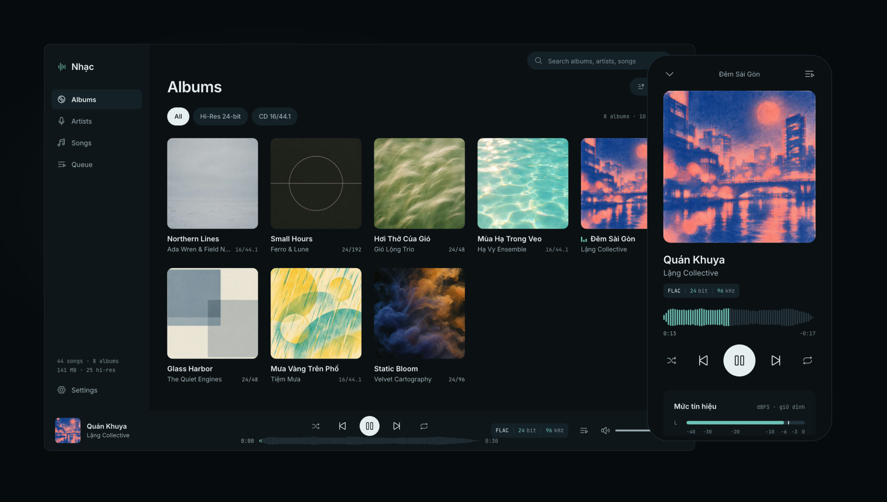
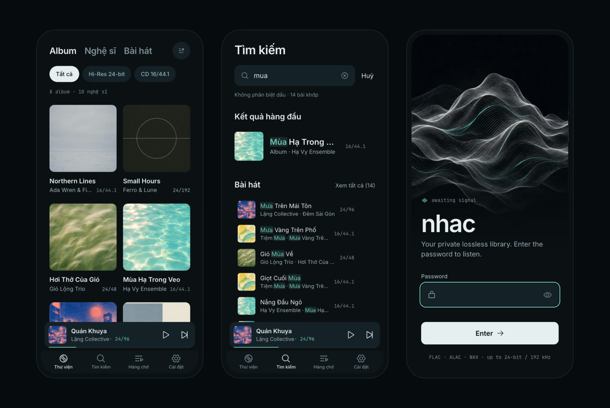
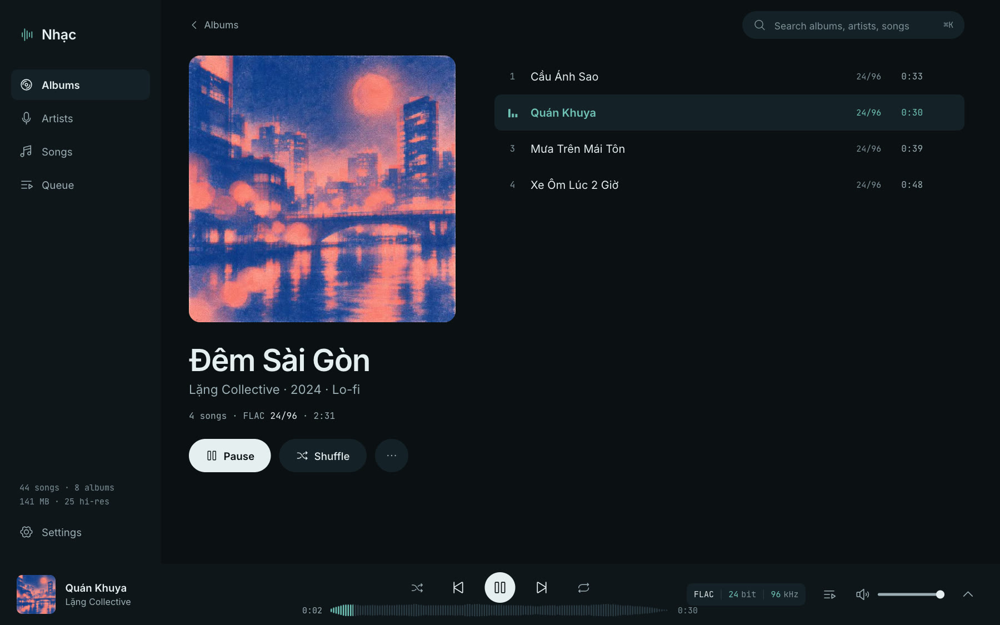
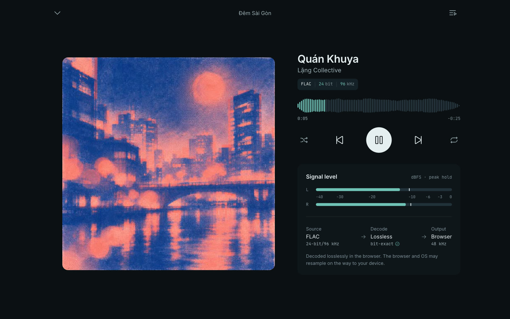
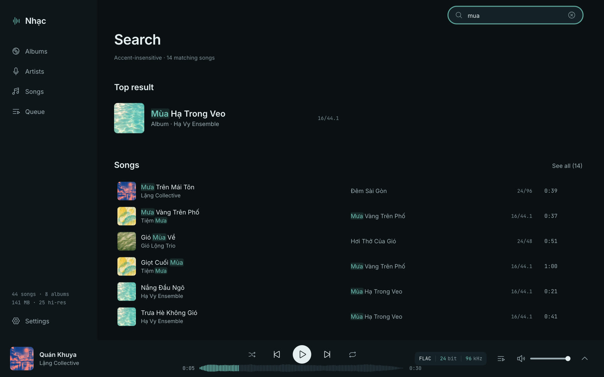
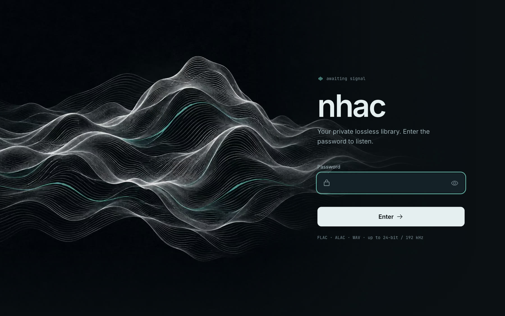
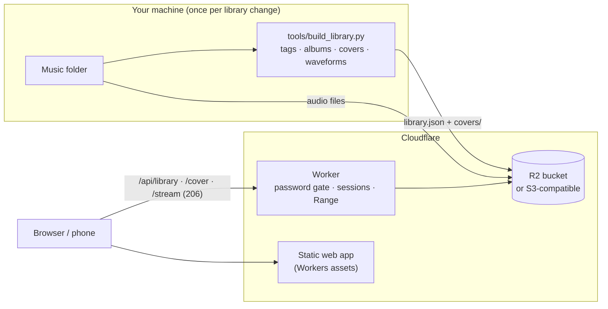

<div align="center">

# nhac

**A self-hosted lossless music player that runs on Cloudflare Workers.**
Stream your own FLAC, ALAC and WAV files at full resolution, up to 24-bit / 192 kHz, from Cloudflare R2 or any S3-compatible bucket.

[](LICENSE)




</div>

*nhac* (Vietnamese for "music") is a private, single-user music player you deploy to your own Cloudflare account. Files stay untouched in your bucket and reach the browser byte for byte: no transcoding, no re-encoding, no lossy stream. A small Worker checks your password and streams with HTTP Range requests; everything else is a fast, static web app.

## Features

- **Bit-exact playback.** Files are served as stored, with Range support for instant seeking. The quality readout shows the real codec, bit depth and sample rate of every track (`FLAC │ 24 bit │ 192 kHz`).
- **R2 or any S3 bucket.** Use an R2 binding, or AWS S3, Backblaze B2, Wasabi, MinIO, R2's S3 API… through signed requests. Nested folders are fine.
- **Waveform seek bar.** Every track gets a real loudness waveform computed once when you index your library.
- **Stereo level meter.** Live L/R levels with peak hold on the Now Playing screen, read from the actual decoded signal (disabled on iOS, where WebKit would cut audio in the background).
- **Honest signal path.** Source → lossless decode → browser output, including the output sample rate the browser actually uses. No "bit-perfect" marketing.
- **Gapless-ish transitions.** The next track is buffered shortly before the current one ends and swapped in on `ended`.
- **Fast at any size.** Albums, songs and artists are virtualized; a 1,000+ album library scrolls smoothly. Progress, waveform and meter update outside the render cycle.
- **Search that understands accents.** `mua` finds "Mưa" and "Mùa", `dem sai gon` finds "Đêm Sài Gòn". Results are ranked across artists, albums and songs, with the matched part highlighted.
- **Feels native on phones.** Bottom tabs, a mini player and a full-screen Now Playing sheet with drag-to-dismiss, lock-screen controls via the Media Session API, safe-area aware, installable as a PWA.
- **Remembers where you were.** Queue, position, volume, shuffle and repeat survive reloads, without touching the network until you press play.
- **Keyboard first.** <kbd>Space</kbd> play/pause, <kbd>←</kbd>/<kbd>→</kbd> seek 10 s, <kbd>Shift</kbd>+<kbd>←</kbd>/<kbd>→</kbd> previous/next, <kbd>M</kbd> mute, <kbd>/</kbd> or <kbd>⌘K</kbd> search.
- **Private by default.** One password, HMAC-signed HttpOnly session cookie, login rate limiting, and nothing of your library is visible before you sign in.
- **English and Vietnamese UI**, picked from your browser language or set in Settings.
- **Motion that respects you.** Short, interruptible transitions on transform and opacity only, and a full `prefers-reduced-motion` path.

<div align="center">

</div>

<table>
<tr>
<td width="50%"></td>
<td width="50%"></td>
</tr>
<tr>
<td width="50%"></td>
<td width="50%"></td>
</tr>
</table>

<sub>Screenshots use the bundled synthetic demo library: every track and cover is generated (see <a href="#try-it-locally-with-the-demo-library">demo library</a>).</sub>

## How it works



The bucket holds your music as-is, plus a small index under a prefix (`_nhac/` by default) that the indexer produces: `library.json` (tracks, albums, formats, waveforms) and one 512 px JPEG per album cover. The Worker never scans the bucket; it reads the index and streams objects.

## Deploy

**Requirements:** a Cloudflare account with R2 enabled (or another S3-compatible bucket), Node.js 20+, Python 3.9+ and ffmpeg/ffprobe on your machine.

1. **Get the code**

   ```sh
   git clone https://github.com/lequocbinh04/nhac && cd nhac
   npm install
   cp wrangler.example.jsonc wrangler.jsonc   # set account_id, bucket name, storage mode
   ```

2. **Upload your music** to the bucket, keeping your folder structure. Any S3 tool works, for example [rclone](https://rclone.org/s3/#cloudflare-r2):

   ```sh
   rclone copy ~/Music r2:music --progress
   ```

3. **Index the library** and upload the index next to the music:

   ```sh
   python3 tools/build_library.py ~/Music --out library-data
   rclone copy library-data r2:music/_nhac --exclude peaks-cache.json
   ```

   Re-run both commands whenever you add music; waveforms are cached, so re-indexing is quick.

4. **Set your password and deploy**

   ```sh
   npx wrangler secret put APP_PASSWORD        # the password you will type
   npx wrangler secret put SESSION_SECRET      # any long random string: openssl rand -hex 32
   npm run deploy
   ```

   On a brand-new Worker, `wrangler deploy` refuses to run before the required secrets exist. Put them in a temporary JSON file and pass it once with `npx wrangler deploy --secrets-file secrets.json`, then delete the file.

### Using an S3-compatible bucket instead of R2

In `wrangler.jsonc` set `"STORAGE": "s3"`, fill `S3_ENDPOINT` (path-style, e.g. `https://s3.eu-central-1.amazonaws.com`), `S3_BUCKET` and `S3_REGION`, remove the `r2_buckets` block, and add the credentials as secrets:

```sh
npx wrangler secret put S3_ACCESS_KEY_ID
npx wrangler secret put S3_SECRET_ACCESS_KEY
```

A read-only key scoped to the bucket is enough.

## Configuration

| Name | Kind | Default | Purpose |
| --- | --- | --- | --- |
| `APP_PASSWORD` | secret | | The password for the login screen. |
| `SESSION_SECRET` | secret | | Signs session cookies. Changing it signs everyone out. |
| `STORAGE` | var | `r2` | `r2` uses the `MUSIC` bucket binding; `s3` uses the S3 settings below. |
| `LIBRARY_PREFIX` | var | `_nhac/` | Where `library.json` and `covers/` live in the bucket. |
| `S3_ENDPOINT`, `S3_BUCKET`, `S3_REGION` | var | | S3 mode only. |
| `S3_ACCESS_KEY_ID`, `S3_SECRET_ACCESS_KEY` | secret | | S3 mode only. |
| `MUSIC` | R2 binding | `music` | R2 mode only. |
| `LOGIN_LIMITER` | rate limit binding | 8 / min | Login attempts per Cloudflare location. |

## Audio formats and browsers

nhac plays whatever your browser can decode, without touching the files:

| Format | Safari (macOS, iOS) | Chrome, Edge | Firefox |
| --- | --- | --- | --- |
| FLAC up to 24/192 | ✓ | ✓ | ✓ |
| WAV, AIFF | ✓ | ✓ (WAV) | ✓ (WAV) |
| ALAC (`.m4a`) | ✓ | ✗ | ✗ |
| AAC, MP3 | ✓ | ✓ | ✓ |

**Tip:** ALAC and FLAC are both lossless, so converting ALAC to FLAC changes nothing in the audio and makes it play everywhere. You can prove it by comparing the decoded audio hashes:

```sh
ffmpeg -i song.m4a -map 0:a -map '0:v?' -c:a flac -c:v copy -disposition:v attached_pic song.flac
ffmpeg -i song.m4a -map 0:a -f md5 -   # these two lines print the same MD5
ffmpeg -i song.flac -map 0:a -f md5 -
```

**Tip:** for the snappiest seeking, give FLAC files a seek table (`metaflac --add-seekpoint=10s *.flac`). Without one, browsers have to bisect the file with several Range requests to find a position.

## Develop

```sh
npm run dev:web      # Vite with HMR on http://localhost:5173
npm run dev          # the Worker on http://127.0.0.1:8787 (Vite proxies /api, /stream, /cover to it);
                     # put APP_PASSWORD and SESSION_SECRET in a .dev.vars file first
npm run check        # type-check Worker + web
npm test             # web unit tests + Worker tests (local R2, sessions, Range, traversal, S3 signing)
npm run build        # production build into public/
```

### Try it locally with the demo library

No Cloudflare account needed: the dev server can read straight from a folder.

```sh
python3 tools/make_demo_library.py demo-music                 # 8 albums, 44 synthesized tracks, 16/44.1 to 24/192
python3 tools/build_library.py demo-music --out demo-library-data
NHAC_MUSIC_DIR=demo-music NHAC_LIBRARY_DIR=demo-library-data npm run dev:web
```

The demo music is synthesized with ffmpeg and the covers in `tools/demo/covers/` are original generated artwork, so the demo is free to use anywhere.

### Project layout

```
src/            Worker: auth, sessions, routing (index.ts) and R2/S3 streaming (storage.ts)
web/            Preact app (index.html) and the login page (login.html), built into public/
web/src/lib/    player engine, queue, search, catalog, meter, i18n (framework-free, unit-tested)
tools/          build_library.py (indexer) and make_demo_library.py (demo generator)
test/           Worker tests with the Cloudflare Vitest integration
```

## Security notes

- The whole app, including the HTML, sits behind the password gate. Only the login page, its assets, the favicon and the web manifest are public.
- Sessions are stateless, HMAC-signed cookies (`HttpOnly`, `Secure`, `SameSite=Lax`) that last 180 days. Rotate `SESSION_SECRET` to revoke every session.
- Login attempts are rate limited per Cloudflare location. Use a long, random password.
- Stream paths are decoded and validated before use: empty, `.` and `..` segments and the index prefix are rejected, so a request can't escape the bucket in S3 mode.

## Credits

- Icons: [Phosphor Icons](https://phosphoricons.com) (MIT), embedded as inline SVG.
- Fonts: [Inter](https://rsms.me/inter/) and [JetBrains Mono](https://www.jetbrains.com/lp/mono/) (SIL Open Font License), self-hosted via Fontsource.
- Motion principles from [Emil Kowalski](https://emilkowal.ski)'s design engineering work.

## License

[MIT](LICENSE) © Lê Quốc Bình
